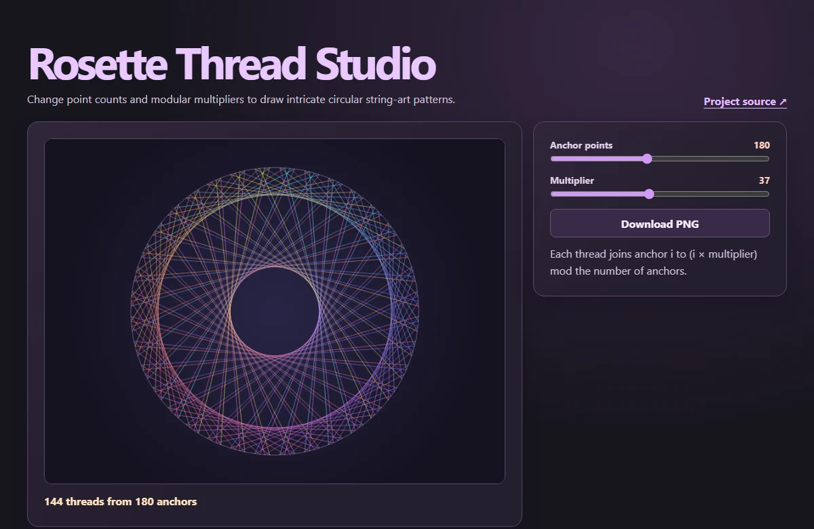

# Rosette Thread Studio

Change point counts and modular multipliers to draw intricate circular string-art patterns.

[Open the browser app](https://surfingcoder.com/apps/rosette-thread-studio/)

## Run locally

Run the following command in this repository and open [localhost:8000](http://localhost:8000).

    python -m http.server 8000

The anchors are equally spaced on a circle. On each redraw, color follows the starting anchor around the perimeter. A thread whose start and end are the same is skipped.

## Verify

Run the following command with Node.js 22 or newer.

    node --test
